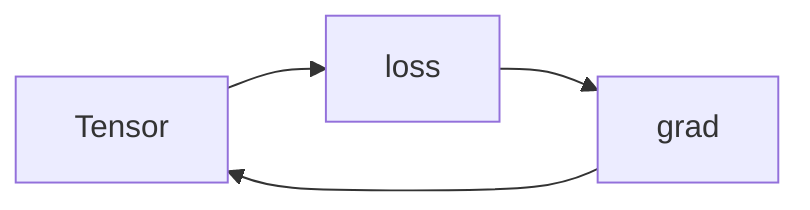

# ember

**A PyTorch-shaped autograd engine in 1,450 lines of pure Python.** No NumPy, zero deps.




```bash
git clone https://github.com/WsNodeX/ember && cd ember
python examples/fit_linear.py   # recovered: y = 3.000 * x + 2.002
```

Tensor autograd · Linear/ReLU/Softmax · MSE/CrossEntropy · SGD · DataLoader. Backward passes are gradient-checked, 60 tests, and `benchmark.py` measures the honest ~110x gap to NumPy.

[Run it in a browser](https://wsnodex.github.io/ember/) · [Full guide](docs/GUIDE.md) · MIT
