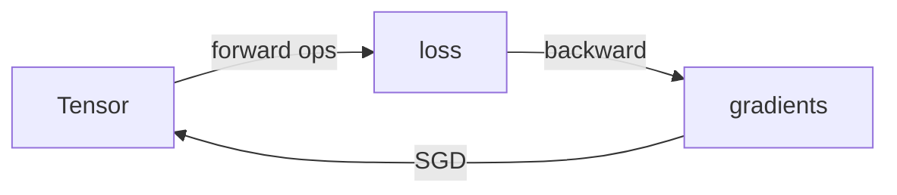

<p align="center">
  <em>A PyTorch-shaped framework in 1,135 lines of pure Python. No NumPy, no pip install.</em>
</p>

<p align="center">
  
  
  
</p>

---

Reverse-mode autograd, layers, losses, an SGD optimizer and a data loader — built
on nothing but the Python standard library. Written to be read end to end.



## Quick start

```bash
git clone https://github.com/WsNodeX/ember && cd ember
python examples/fit_linear.py
```

```text
epoch   0  loss=4.4556
epoch 199  loss=0.0030

recovered: y = 3.000 * x + 2.002   (true: y = 3.000 * x + 2.000)
fit error on weight: 0.0004, on bias: 0.0022
```

200 epochs in 0.58s. Or five lines, inline:

```python
import ember as eb

x = eb.Tensor([2.0])
y = (x * x).sum()
y.backward()
print(x.grad)          # [4.0]
```

XOR, which needs a hidden layer and a non-linearity:

```bash
python examples/xor_mlp.py     # accuracy: 4/4
```

## Why this exists

`micrograd` teaches backprop on scalars. Ember is the next size up: the tensor
supports matrices, so `Linear(2, 8)` and `CrossEntropyLoss` actually work, and
there is a real optimizer and a real data loader.

The tradeoff is that it is slow and it will stay slow — every op is a Python loop.
That is the point. It is not a PyTorch competitor; it is the thing PyTorch is made
of, small enough to hold in your head. If you need speed, use PyTorch. If you want
to stop treating `.backward()` as magic, read this.

## API

| Name | What it is |
|---|---|
| `Tensor` | Differentiable scalar, vector or matrix — `.data`, `.grad`, `.backward()` |
| `nn.Linear / ReLU / Sigmoid / Tanh / Softmax` | Layers and activations |
| `nn.Sequential` | Compose modules |
| `nn.MSELoss / CrossEntropyLoss / BCEWithLogitsLoss` | Losses with analytic backward |
| `SGD` | Momentum, Nesterov, L2 weight decay |
| `TensorDataset / DataLoader` | Mini-batching with shuffling |
| `ember.array` | The pure-Python tensor backend, if you want to poke at it |

Every op's forward math and its backward rule live in the same file, next to each
other, in plain Python.

## Tests

```bash
pip install pytest && python -m pytest -q
# 60 passed in 1.25s
```

Every operation is gradient-checked against central finite differences
(`tests/utils.py`). If a backward pass is wrong, a test fails — that is the whole
verification story, and it is why the engine is trustworthy enough to learn from.

## Limitations

- **Pure Python loops.** No NumPy, so matmul is a triple nested loop. It is slow,
  and because the whole point is readability it stays slow.
- **No GPU, no vectorisation, no plans for either.** Adding them means adding
  NumPy, which defeats the premise.
- **Not thread-safe.** The engine assumes a single writer.
- **No convolutions or RNNs.** `Linear`, activations and losses only.

## License

MIT
